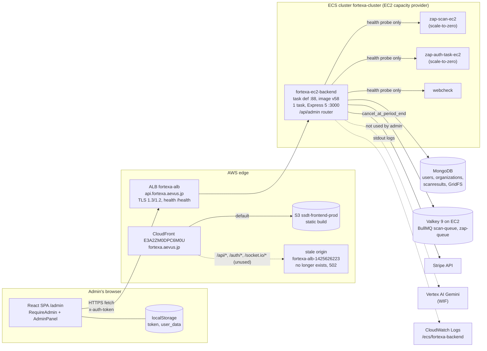
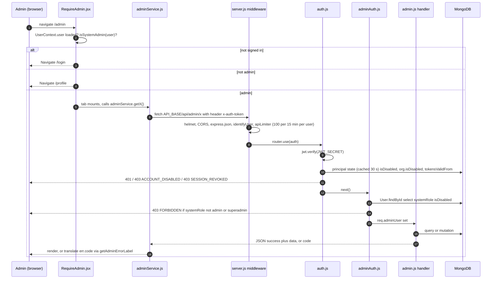
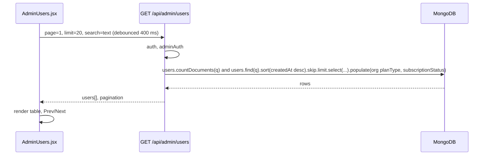
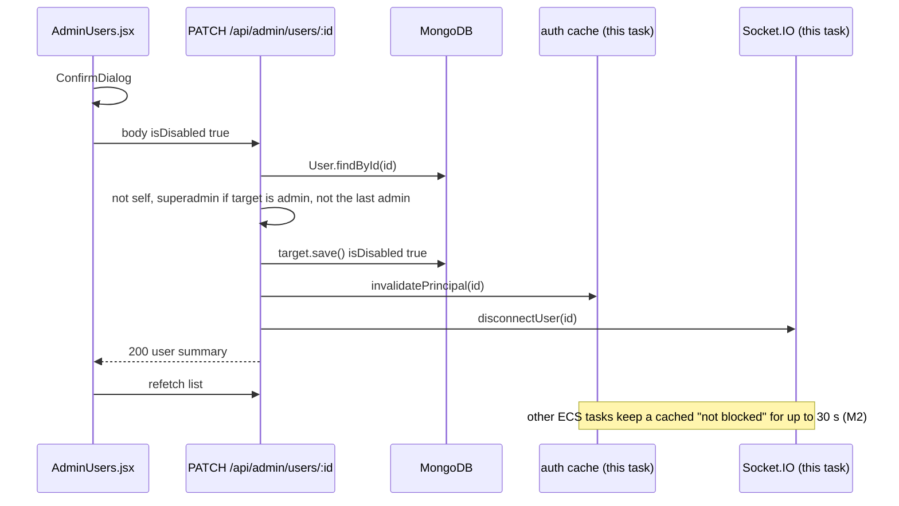
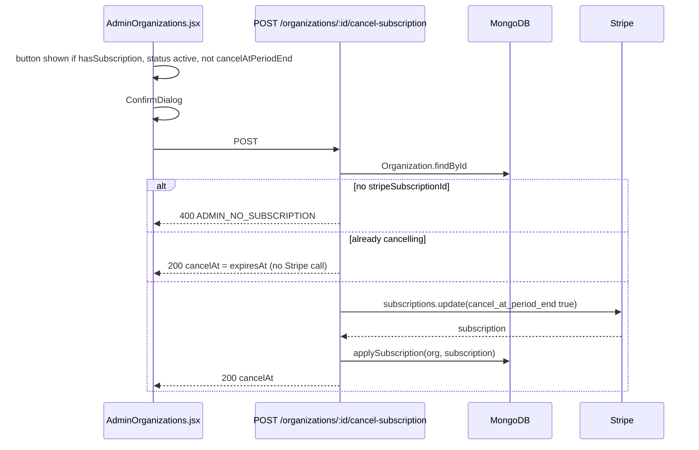
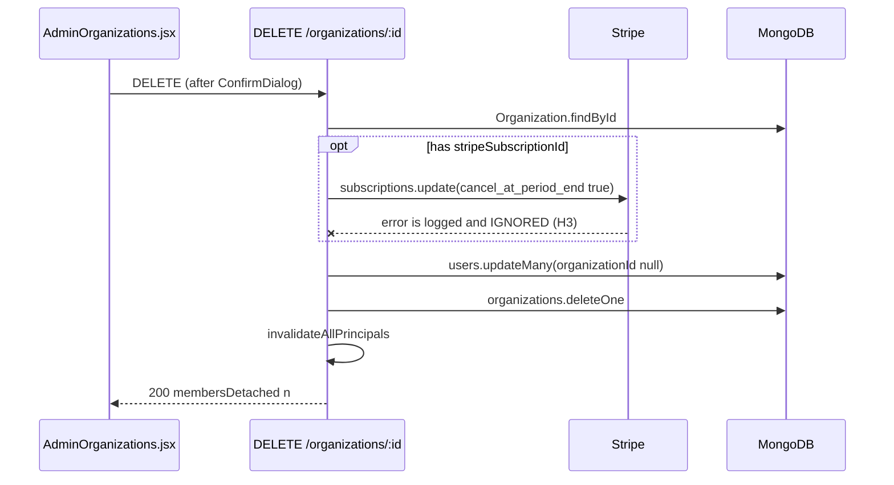

# Fortexa Admin Dashboard: Architecture, Production Connectivity and Readiness Audit

| | |
|---|---|
| **Audit date** | 2026-10-19 |
| **Repository state** | `main` @ `9dbdeb5` (clean). Admin backend last changed in `2cad280` (2026-10-14) |
| **Method** | Read-only. Source inspection; local test runs; unauthenticated GET/OPTIONS probes of the public production endpoints; **read-only AWS API calls** (describe/list/get, CloudWatch Logs Insights queries, one ECR image-layer download) as SSO role `PowerUser-With-IAM-Read`, account 459181228792, `ap-northeast-1`, on 2026-10-19 |
| **Not done** | No code, config, infrastructure or database change. No authenticated production call. No secret value read. No database query |

**Status labels used throughout**

| Label | Meaning |
|---|---|
| **VERIFIED** | Supported by direct evidence, runtime evidence where runtime is what matters |
| **PARTIALLY VERIFIED** | Some, but not all, of the required evidence exists |
| **FAILED** | Evidence shows a defect |
| **UNKNOWN** | The evidence is not available to this audit |
| **NOT IMPLEMENTED** | The functionality does not exist |

---

## 1. Executive summary

Fortexa has a working platform admin dashboard at `https://fortexa.aevus.jp/admin`. It is a section of the main React app, not a separate application, and it talks to the same production API (`https://api.fortexa.aevus.jp`) as the rest of the product.

**What it does today.** Six tabs:

| Tab | What it shows or does |
|---|---|
| **Overview** | Headline counts |
| **Analytics** | 30-day sign-ups, plan mix, estimated recurring revenue, 7-day scan activity |
| **Users** | Search, enable/disable, delete, remove from organization, grant/revoke admin |
| **Organizations** | Search, filter by plan, enable/disable, cancel subscription at period end, delete |
| **Scans** | A list of recent scans with status, read-only |
| **System Health** | Live status of the database, cache, queue and scanner services |

**What it does not do.** It cannot:
- open a single user, organization or scan in detail;
- view reports, PDFs or HTTP evidence;
- retry or cancel scans;
- inspect failed background jobs;
- read logs;
- manage email, coupons, settings or quota.

It also keeps **no audit history** of what administrators did.

**Is it connected to production?** Yes. Everything short of signing in has been verified:
- The live website's code calls the production API.
- The production backend runs exactly the code in this repository: all 136 application files in the running container image are identical to `main`.
- The production API has the admin endpoints installed and protects them, and CORS allows the live website to call them.

**It has never been used in production.** Production logs are kept back to 2026-04-25, about 2.3 million lines. In that whole period, not one request from a real administrator reached an admin endpoint. The only hits were internet scanners probing for files (all rejected) and this audit's own probe. So nobody has yet confirmed that an administrator can sign in and work with live data. The project's handoff notes list that check as never performed (`HANDOFF.md:113-119`), and the logs confirm it.

**Is it safe to rely on?** Partly:
- **Server-side access control is real.** Every admin endpoint re-checks the caller's role in the database on every request; hiding buttons is not the protection.
- **Three issues need fixing before routine use:**
  1. Any ordinary admin, not just a superadmin, can **permanently delete an organization** or **cancel its Stripe subscription**.
  2. Deleting an organization **silently continues if Stripe refuses the cancellation**, so a customer can keep being billed for an organization that no longer exists.
  3. **No action is recorded** in a durable audit log.
- **Some numbers on the dashboard are wrong:**
  - "Total Scans (All-Time)" is in fact a stale 7-day count.
  - The health page always shows the AI service as "not configured", and the scanners as "offline" whenever they are scaled to zero.
- **Nothing alerts anyone when the API breaks.** AWS has 17 alarms configured, but none watches the backend API: no alarm for server errors, unhealthy servers or crashed tasks. A broken API is discovered when a customer complains.

**Recommendation.** **Conditional GO:**
- Named superadmins may use it for **read-only monitoring** and for **disabling/enabling user accounts**, once a 30-minute signed-in smoke test passes (§13, ADM-01…05). That test will be the first production use ever.
- **NO-GO** for organization deletion and subscription cancellation until the Stage 1 fixes in §14 land.

---

## 2. Direct answer: is the dashboard connected to production?

**Yes. Every link from the browser to the database is verified, and the running backend is byte-identical to the audited code. Signed-in use against live data is UNKNOWN, because it has never happened.**

| Question | Answer | Status |
|---|---|---|
| Does the live admin UI call the production API? | Yes. The live bundle `main.4c9eda6e.js` contains only `https://api.fortexa.aevus.jp`, with no `localhost`, ALB or staging host | **VERIFIED** |
| Does the live UI contain the admin dashboard? | Yes. All 9 `/api/admin/*` paths and the admin strings are in the live bundle | **VERIFIED** |
| Are the admin API routes deployed? | Yes. `GET /api/admin/kpis` and `/api/admin/<anything>` return **401 from the admin router's auth guard**, while `/api/zzz` returns **404** | **VERIFIED** |
| Will the API accept calls from the live site? | Yes. The preflight from `https://fortexa.aevus.jp` returns 204 with the right `Allow-Origin`, `Allow-Headers: x-auth-token` and `PATCH/DELETE` | **VERIFIED** |
| Is the live frontend the current code? | CloudFront `E3A2ZM0DPC6M0U` (`fortexa.aevus.jp`) serves S3 bucket `ssdt-frontend-prod` (ap-northeast-1). Its `index.html` was uploaded 2026-10-13 14:25:18 UTC, matching the live response, and the bundle contains HEAD's admin strings | **VERIFIED** |
| Is the deployed backend the current `admin.js` (HEAD)? | Yes. Service `fortexa-ec2-backend` runs one task on **`fortexa-backend:88`**, image **`v58`**, pinned by digest `sha256:0d5a9e1c…98ad`. Its application layer was downloaded from ECR (hash matched its digest) and every file compared with `backend/` at HEAD: **136 identical, 0 different, 0 extra** | **VERIFIED** |
| Does the load balancer route to it? | `api.fortexa.aevus.jp` → ALB `fortexa-alb` (HTTPS 443, TLS 1.3/1.2 policy, ACM certificate valid to 2027-04-15; port 80 redirects to HTTPS) → target group `fortexa-tg` :3000 → **1 target, healthy** | **VERIFIED** |
| Can a real admin sign in and see real data? | Never happened: no real admin API request in the logs since 2026-04-25 | **UNKNOWN** (never exercised) |
| Is it the production MongoDB? | The task's `MONGO_URI` comes from `fortexa-backend-secrets` (value not read; last changed 2026-10-03), and `/ready` reports it connected. The admin router shares the one Mongoose connection the whole product uses, so it reads and writes the same data customers see | **VERIFIED** (same DB as the product; cluster identity not inspected) |

---

## 3. Evidence and remaining unknowns

### 3.1 Production probes (2026-10-19, unauthenticated, read-only)

| Probe | Result | What it proves | What it does not prove |
|---|---|---|---|
| `GET api.fortexa.aevus.jp/health` | 200, uptime 496 930 s (about 5.75 days, so the task started around 2026-10-13) | The API is up | Which image is running |
| `GET /ready` | 200: mongodb connected, redis ready, webcheck ready | The DB, cache and WebCheck are reachable from the API | Which DB |
| `GET /api/admin/kpis` with no token | 401 `{"error":"UNAUTHORIZED","message":"No token, authorization denied"}` | The `/api/admin` router is mounted and its `auth` runs first (`admin.js:84`) | That `adminAuth` and each handler behave as in HEAD |
| `GET /api/admin/nonexistent-route` with no token | 401 (same body) | The guard runs before route matching, so unknown admin paths are not enumerable | — |
| `GET /api/zzz-nonexistent` | 404 | The admin 401 is not a generic catch-all | — |
| `OPTIONS /api/admin/users/x` from `Origin: https://fortexa.aevus.jp` | 204, ACAO = that origin, methods include `PATCH, DELETE`, HSTS 1 year | CORS and HTTPS are correct for the live site | — |
| `GET /api/admin/kpis` from `Origin: https://evil.example` | **500** with no ACAO | A disallowed origin is blocked by the browser | That the status is right; it should be 403 (Finding L1) |
| `GET https://fortexa.aevus.jp/` | 200 via CloudFront; `index.html` and the main bundle Last-Modified 2026-10-13 14:24–14:25 UTC | The frontend is served from S3 + CloudFront | — |
| grep of the live bundle | Contains strings added in HEAD commit `b7ebadb`: `planStatusCancelling`, `cancellationScheduledNote`, `cancelAtPeriodEnd`, `hasSubscription` | The live UI matches HEAD's admin code | That it is byte-identical. The bundle predates the commit timestamp (2026-10-14 13:27 IST), so it was built from the working tree before the commit was made |

### 3.2 Local test runs (2026-10-19)

| Suite | Result |
|---|---|
| `cd backend && npm test` | **335 / 335 pass** (30.5 s) |
| `cd frontend && CI=true npx react-scripts test --watchAll=false` | **50 / 50 pass** |

These tests are mostly **static analysis**: they read source files and assert on patterns, a "census" of things like every `jwt.sign`. The admin tests do not start the server or call admin handlers against a database. They prove the code is shaped correctly, not that it behaves correctly at runtime.

### 3.3 AWS (2026-10-19, read-only)

All calls ran as `ssdt-profile` (SSO role `AWSReservedSSO_PowerUser-With-IAM-Read`, account 459181228792, region `ap-northeast-1`). That role *can* make changes, so only `describe`/`list`/`get` calls, Logs Insights queries and `ecr get-download-url-for-layer` were used. Commands are in §16.2.

| Check | Result | Status |
|---|---|---|
| ECS service | Cluster `fortexa-cluster`, service `fortexa-ec2-backend`: ACTIVE, capacity provider `fortexa-ec2-capacity-provider` (EC2, **not Fargate**), **desired 1 / running 1**, circuit breaker with rollback on, Service Connect on | VERIFIED |
| Active deployment | `fortexa-backend:88`, created 2026-10-13 19:54 IST, rollout COMPLETED 20:02 IST; task started 20:01:38 IST, HEALTHY. Steady-state events every ~6 h since; no failures | VERIFIED |
| **Docs are out of date** | CLAUDE.md says production is `:86` / image `v55`. It is **`:88` / `v58`**. Revision 88 was registered by the same SSO user on 2026-10-13 19:53 IST | **FAILED** (documentation drift) |
| Task definition 88 | Image pinned by digest; port 3000; **no container health check**; logs to `/ecs/fortexa-backend`. 23 secrets, by name: incl. `MONGO_URI`, `JWT_SECRET`, `REDIS_URL`, `REDIS_TLS_CA`, `REDIS_TLS_SERVERNAME`, `STRIPE_*`. **No `ELASTICACHE_REDIS_URL`** and **no `GEMINI_API_KEY`**. Env includes `NODE_ENV=production`, `FRONTEND_URL=https://fortexa.aevus.jp`, `RATE_LIMIT_ENABLED=true`, `API_RATE_LIMIT_MAX=100`, `ZAP_CAPACITY_MANAGED=true` | VERIFIED |
| ECR image | Digest `sha256:0d5a9e1c…98ad` = tag **`v58`**, pushed 2026-10-13 19:48 IST. Previous tags `v57`/`v56` from 2026-10-10 | VERIFIED |
| **Image contents vs git** | amd64 manifest `sha256:a43b766a…`, 10 layers. Layer 10 (`COPY . .`, 34.5 MB) downloaded; its SHA-256 equals its digest. Extracted and compared file by file with `git show HEAD:backend/<f>` (line endings normalised): **136 identical, 0 different, 0 files not in git**. No `.env` and no `node_modules` in the layer (`backend/.dockerignore` works) | **VERIFIED** |
| ALB | `fortexa-alb` (internet-facing, active). Listener 443 HTTPS, policy `ELBSecurityPolicy-TLS13-1-2-Res-PQ-2025-09`, ACM cert for `api.fortexa.aevus.jp` ISSUED, valid to 2027-04-15, renewal-eligible. Listener 80 redirects to HTTPS. One default rule each, so **no path or IP restriction on `/api/admin`** | VERIFIED |
| Target group | `fortexa-tg`, HTTP :3000, type ip, health check **`/health`** every 30 s (5 healthy / 2 unhealthy), matcher 200. 1 target **healthy** | VERIFIED |
| ALB attributes | access logs **off**, deletion protection **off**, `drop_invalid_header_fields` **off**, idle timeout 60 s | VERIFIED (see I6) |
| CloudFront | `E3A2ZM0DPC6M0U` = `fortexa.aevus.jp`, TLSv1.2_2021, redirect-to-https. Default behaviour → S3 `ssdt-frontend-prod` via origin access control; SPA fallback 403/404 → `/index.html`. **`/api/*`, `/auth/*`, `/socket.io/*` still go to an origin `fortexa-alb-1425626223…` that no longer exists**; `https://fortexa.aevus.jp/api/admin/kpis` returns **502** "Error from cloudfront" | VERIFIED (see L8) |
| Frontend bucket | `ssdt-frontend-prod` is in **ap-northeast-1** (the workflow says `ap-south-1`). `index.html` last modified 2026-10-13 14:25:18 UTC with **no `Cache-Control`**. The workflow always sets `no-cache, no-store` on root files, so **this deploy was not done by the GitHub workflow**. The last CloudFront invalidation was 2026-10-10 | VERIFIED |
| CloudWatch alarms | 17 alarms: Valkey/Redis (9), autoscaling target-tracking (6), one unrelated EC2. **None for the backend API**: no ALB 5xx, unhealthy-host, ECS running-task or log-error alarm | VERIFIED (see M8) |
| Log groups | `/ecs/fortexa-backend`: 2,322,972 lines, 2026-04-25 → today, about 203 MB, **retention: never expire**. `/ecs/fortexa-backend-service-0qhpn4vc`: older service, 2026-05-05 → 2026-07-31 | VERIFIED (see L7) |
| **Admin usage in logs** | Request-log lines for `/api/admin/{kpis,users,organizations,scans,system-health,analytics}` since 2026-04-25: **1**, this audit's probe. Every other `/api/admin` hit is a scanner (`/api/admin.env`, `.key`, `.tar`, `/ghost/api/admin/users/`, …), all answered 401. **Zero** `[admin]` action lines, **zero** `adminAuth` denials | **VERIFIED: never used in production** |
| Secrets Manager | `fortexa-backend-secrets` (metadata only): last changed 2026-10-03, rotation not configured | VERIFIED |

**Release timeline (why the code matches but git didn't show it).** The backend image `v58` was pushed 2026-10-13 19:48 IST and the frontend uploaded 19:55 IST. Commits `2cad280` and `b7ebadb`, which contain that code, are dated 2026-10-14 13:26–13:27 IST. Both releases were built by hand from the working tree **before** the code was committed. The result is correct this time, but nothing would have caught it if the commit had differed from what was shipped (Finding I7).

### 3.4 Unknowns that remain

1. **Whether an administrator can sign in and use the dashboard.** It has never been done (§3.3). Run ADM-01…05 (§13).
2. **Who holds `admin` / `superadmin` in production, if anyone.** Needs a read-only DB count by an engineer. If there are none, the bootstrap in §12.1 is needed first.
3. Which MongoDB cluster `MONGO_URI` points at, and its backup / point-in-time-restore settings (the only recovery for admin deletions).
4. Whether the GitHub `frontend-deploy` workflow has ever succeeded. `gh` is not installed here and the repository is private.

### 3.5 Local run (2026-10-20)

The dashboard was run end to end on a developer machine against an **isolated, throwaway MongoDB 7.0.15** bound to `127.0.0.1`, seeded with 8 users, 2 organizations and 6 scans. It was not run against the Atlas cluster in `backend/.env`, because nobody could confirm that cluster is not production.
- **Overrides (command line only; `.env` not edited):** `MONGO_URI` → local; `REDIS_URL` empty; `SCHEDULER_ENABLED=false`; `DISABLE_WORKER=true`; email credentials empty.
- **Frontend:** `react-scripts start`, with headless Chrome (Puppeteer) as the driver.

| Check | Result |
|---|---|
| Superadmin login → lands on `/admin` | **PASS** (ADM-01, locally) |
| All six tabs load | **PASS**: every `GET /api/admin/*` returned 200; no browser console errors |
| Disable a user from the Users tab (confirm dialog) | **PASS**: `PATCH /users/:id` 200; the target's own token went from 200 to **403** on its next request; Enable restored 200 (ADM-11/12, locally) |
| "Total Scans (All-Time)" | Showed **0** while the seeded orgs record 15 billed scans and 6 scan documents existed: **M5 reproduced** |
| Seeded failed scan | **Deleted within seconds of server start** by the cleanup job: **L9** |
| "Last login" column | Shows the creation date for users who never signed in, and was not updated by the superadmin's own login: **L10** |
| Users table layout | The Name cell sits higher than the rest of the row (cosmetic) |

This proves the code works as a whole on a real browser and database. It does not prove anything about production data or production sign-in (§3.4 item 1).

---

## 4. Current architecture



Sources (all verified live on 2026-10-19 unless noted, §3.3):
- `api.fortexa.aevus.jp` → ALB `fortexa-alb` → target group `fortexa-tg` → the single backend task; one proxy hop, matching `backend/server.js:63-77`.
- Frontend: CloudFront → S3 `ssdt-frontend-prod`. The `/api/*`, `/auth/*` and `/socket.io/*` behaviours point at a deleted ALB, and the SPA does not use them (it calls `api.fortexa.aevus.jp` directly).
- Cluster, service, task definition and image: ECS and ECR describe calls. The backend runs on an **EC2 capacity provider, not Fargate**.
- ZAP, ZAP-auth and WebCheck run as separate ECS services (`zap-scan-ec2`, `zap-auth-task-ec2`, `webcheck-task-ec2`), reached through Service Connect.

---

## 5. Admin request flow (frontend → backend)



| Step | Evidence |
|---|---|
| Route guard | `frontend/src/App.js:46-47`, `frontend/src/components/RequireAdmin.jsx:24-41` |
| API base URL | `frontend/src/config/api.js:4`. Build-time `REACT_APP_API_URL`, falls back to `http://localhost:3001` |
| Token header | `frontend/src/services/adminService.js:7-13` (`x-auth-token` from `localStorage.token`) |
| Error handling | `adminService.js:15-29`, then `pages/Admin/adminLabels.js:120-123` |
| Mount and limiter | `backend/server.js:209` |
| Auth | `backend/middleware/auth.js:118-179` (verify :133, principal state :141, fail-open :165-167) |
| Admin role | `backend/middleware/adminAuth.js:20` (DB read, not JWT), :40-48 |
| Router guard | `backend/routes/admin.js:84` — `router.use(auth, adminAuth)` covers **every** admin route |

---

## 6. Admin page and feature inventory

**Entry:**
- After login, an admin lands on `/admin` (`utils/authRedirect.js:20`, used by `LoginPage.jsx:50,87` and `OTPVerification.jsx:51`).
- Tabs are selected by URL hash, e.g. `/admin#users` (`AdminPanel.jsx:47-57`).
- The header shows an "Admin" or "Superadmin" badge (`AdminPanel.jsx:86-91`).

### 6.1 Overview tab (`AdminOverview.jsx`)

| Element | What the admin sees | Source | Notes |
|---|---|---|---|
| Total Users | `User.countDocuments({})` | `admin.js:99` | Correct |
| Verified Users | `isVerified: true` | `admin.js:100` | Correct |
| Active Orgs | `subscriptionStatus: 'active'` | `admin.js:101` | **Inaccurate**: ignores expiry/entitlement (Finding M6) |
| Total Orgs | all orgs | `admin.js:102` | Correct |
| Running Scans | `status ∈ queued, pending, combining` | `admin.js:104` | Correct (subject to the 7-day TTL) |
| Total Scans (All-Time) | sum of `User.totalScans` | `admin.js:103` | **FAILED**: see Finding M5 |
| Plan Distribution bars | `Organization` grouped by `planType` | `admin.js:109-112` | Correct; `null` = Free |
| Recent Registrations | last 5 users (name, email, joined) | `admin.js:105` | Correct |
| Retry button | appears on error | `AdminOverview.jsx:43-49` | — |

### 6.2 Analytics tab (`AdminAnalytics.jsx`)

| Element | Source | Notes |
|---|---|---|
| User growth, 30 days | `admin.js:508-511` | UTC days, zero-filled |
| Organization growth, 30 days | `admin.js:512-515` | — |
| Plan distribution | `admin.js:516-519` | — |
| Subscription status distribution | `admin.js:520-523` | — |
| Estimated recurring value (¥/month) | `admin.js:524-547`, `config/planCatalog.js monthlyEquivalent` | Labelled an **estimate**; counts `status:'active'` only (M6); no invoices are stored anywhere |
| Scan activity, 7 days, by status | `admin.js:527-572` | Limited by the 7-day TTL on ScanResult |
| Top 8 orgs by `scansUsed` | `admin.js:531-535` | — |

### 6.3 Users tab (`AdminUsers.jsx`)

| Element | Behaviour | API |
|---|---|---|
| Search box (400 ms debounce) | name or email, case-insensitive, regex-escaped | `GET /users?search=` |
| Table | Name (+ role badge), Email, Org role, Plan, Status (Disabled/Verified/Unverified), Joined, Last login, Actions | — |
| Pagination | Prev/Next, 20 per page | `page`, `limit` |
| **Make Admin** (superadmin only, target is `user`) | Confirm dialog, then sets `systemRole:'admin'` | `PATCH /users/:id` |
| **Remove Admin** (superadmin only, target is `admin`) | Confirm, then `systemRole:'user'` | `PATCH /users/:id` |
| **Disable** / **Enable** | Disable needs confirmation; Enable does not | `PATCH /users/:id {isDisabled}` |
| **Remove from org** (has org, not owner) | Confirm | `DELETE /users/:id/organization` |
| **Delete** | Confirm | `DELETE /users/:id` |
| Own row | Shows "You" and no actions | `AdminUsers.jsx:259,285-286` |

Not in the UI, although the backend supports them:
- filters by org `role` and `systemRole` (`admin.js:151-152`);
- promotion to `superadmin` (only the script can do that).

Plain admins see **Disable/Delete** on admin rows, and the server will refuse those (Finding L3).

### 6.4 Organizations tab (`AdminOrganizations.jsx`)

| Element | Behaviour | API |
|---|---|---|
| Search (org name) and Plan filter (pro/basic/light/trial1/trial2) | debounced | `GET /organizations?search=&plan=` |
| Table | Name, Owner email, Plan, Seats used/allowed, Scans used/limit, Subscription status (or Disabled), Created, Actions | — |
| **Cancel subscription** | shown if `hasSubscription && status==='active' && !cancelAtPeriodEnd` (`:253`); confirm | `POST /organizations/:id/cancel-subscription` |
| **Disable** / **Enable** | confirm on disable | `PATCH /organizations/:id {isDisabled}` |
| **Delete** | confirm | `DELETE /organizations/:id` |

There is no subscription-status filter in the UI, although the backend supports `status` (`admin.js:201`).

### 6.5 Scans tab (`AdminScans.jsx`) — read-only

| Element | Notes |
|---|---|
| Status filter: all, queued, pending, combining, completed, failed, stopped | `cancelled` is missing even though the model allows it (`ScanResult.js:54`, `AdminScans.jsx:32`) |
| Table: Target URL, User email, Plan, Status, Started, Duration | Duration = `updatedAt − createdAt`; for running scans this is "time since last update", not elapsed time |
| No row action, no link to the result | **NOT IMPLEMENTED** |

### 6.6 System Health tab (`AdminSystemHealth.jsx`)

- Ten cards: Server, MongoDB, Redis, Queue, WebCheck, ZAP, ZAP-Auth, Gemini, PageSpeed, urlscan.
- A manual Refresh button, plus auto-refresh every 30 s (`:154-157`).
- An "online x / 10" badge (`:178-191`).
- Error text from the backend goes to the browser console only; the card shows a translated "unreachable" (`:96-104`).

See Finding M7 for the false alarms on this page.

---

## 7. API endpoint inventory

Every route below is mounted at `/api/admin` (`server.js:209`) behind `identifyUser → apiLimiter → auth → adminAuth`, so the **minimum permission for all of them is `systemRole ∈ {admin, superadmin}`, not disabled, in an org that is not disabled, with a token issued after the last password reset.**

| # | Method and path | Handler | Reads/Writes | Extra permission rule | Response | Side effects |
|---|---|---|---|---|---|---|
| 1 | `GET /kpis` | `admin.js:88-134` | R: users, organizations, scanresults | — | `{kpis, planDistribution, recentUsers}` | none |
| 2 | `GET /users` | `:138-186` | R: users (+ org populate) | — | `{users[], pagination}` (no password/OTP, explicit projection `:160`) | none |
| 3 | `GET /organizations` | `:190-254` | R: organizations, users (owners) | — | `{organizations[], pagination}`; Stripe ids **not** sent (`:233-238`) | none |
| 4 | `GET /scans` | `:258-315` | R: scanresults, users | — | `{scans[], pagination}`; scan payloads **not** sent (`:273-278`) | none |
| 5 | `GET /system-health` | `:319-448` | R: Mongo stats, Redis PING, BullMQ counts, HTTP to WebCheck/ZAP/ZAP-auth; env presence | — | `{checks{}, timestamp}` | outbound HTTP to 3 internal services |
| 6 | `GET /analytics` | `:492-592` | R: users, organizations, scanresults | — | series and distributions | none |
| 7 | `PATCH /users/:id` | `:601-678` | **W: users.systemRole / isDisabled** | role change: never self; **superadmin** if the target is or becomes an admin; last-admin guard. Disable: never self; **superadmin** if the target holds an admin role; last-admin guard | `{user{_id,name,email,systemRole,isDisabled}}` | auth-cache invalidation; socket disconnect (this task only) |
| 8 | `DELETE /users/:id/organization` | `:682-715` | **W: user.organizationId=null; org.seatsUsed recount** | **superadmin** if the target is an admin; owners refused (409) | `{success}` | cache invalidation |
| 9 | `DELETE /users/:id` | `:719-764` | **W: delete user; org.seatsUsed recount** | never self; **superadmin** if the target is an admin; owners refused; last-admin guard | `{success}` | cache invalidation; socket disconnect |
| 10 | `PATCH /organizations/:id` | `:769-807` | **W: org.isDisabled** | **any admin**; only guard is "a reachable admin remains" (`:784`) | `{organization{_id,name,isDisabled}}` | clears the whole auth cache; disconnects members' sockets |
| 11 | `POST /organizations/:id/cancel-subscription` | `:816-848` | **W: Stripe `subscriptions.update(cancel_at_period_end)` → `applySubscription(org)`** | **any admin** | `{cancelAt}` | **external, irreversible billing change**; one `console.log` (`:838`) |
| 12 | `DELETE /organizations/:id` | `:855-887` | **W: Stripe cancel (best-effort); users.updateMany organizationId=null; delete org** | **any admin** | `{membersDetached}` | **irreversible**; one `console.log` (`:880`) |

**Frontend ↔ backend compatibility.** All 12 client methods in `adminService.js:31-111` match the method, path and body of the backend routes. Query parameters sent by the UI (`page`, `limit`, `search`, `plan`, `status`) are all read by the backend. **No mock data, sample records or placeholder endpoints were found** in the admin frontend or the admin router.

---

## 8. Feature implementation and deployment matrix

The columns are kept separate on purpose:
- **Static test** = a repo test asserts on the source.
- **Integration** = a test executes the handler.
- **Staging** = none exists; no staging environment appears anywhere in the repo.
- **Prod-deployed** = evidence that the code is live. §3.3 proved the running image is identical to HEAD, so every implemented feature is deployed.
- **Prod-smoke** = someone exercised it, signed in, against production. The logs show this has **never** happened for any admin feature.

| Feature | Implemented | Static test | Integration test | Staging | Prod-deployed | Prod-smoke | Current status |
|---|---|---|---|---|---|---|---|
| `/admin` route guard (UI) | Yes | Yes (`appInvariants` RequireAdmin table) | — | none | **VERIFIED** (in bundle) | never (logs) | PARTIALLY VERIFIED |
| Server-side admin authZ | Yes | Yes (census tests) | No | none | **VERIFIED** (image = HEAD; 401 live) | never (logs) | PARTIALLY VERIFIED |
| KPIs | Yes | projection only | No | none | **VERIFIED** | never (logs) | **FAILED** (Total Scans KPI), rest PARTIALLY VERIFIED |
| Analytics | Yes | No | No | none | **VERIFIED** | never (logs) | PARTIALLY VERIFIED (estimate caveats) |
| User list/search | Yes | regex-escape test | No | none | **VERIFIED** | never (logs) | PARTIALLY VERIFIED |
| User disable/enable | Yes | hierarchy, cache-invalidation census | No | none | **VERIFIED** | **never** (logs; `HANDOFF.md:116-118`) | PARTIALLY VERIFIED |
| Grant/revoke admin | Yes | hierarchy test | No | none | **VERIFIED** | never (logs) | PARTIALLY VERIFIED |
| Remove user from org | Yes | No | No | none | **VERIFIED** | never (logs) | PARTIALLY VERIFIED |
| Delete user | Yes | hierarchy test | No | none | **VERIFIED** | never (logs) | PARTIALLY VERIFIED |
| Org list/search/plan filter | Yes | projection test | No | none | **VERIFIED** | never (logs) | PARTIALLY VERIFIED |
| Org disable/enable | Yes | last-admin-org test | No | none | **VERIFIED** | **never** (logs) | PARTIALLY VERIFIED; hierarchy gap (M1) |
| Cancel org subscription | Yes | No (admin path) | No (user path is covered in `subscriptionLifecycle.test.js`) | none | **VERIFIED** | never (logs) | PARTIALLY VERIFIED; permission gap (H1) |
| Delete org | Yes | No | No | none | **VERIFIED** | never (logs) | **FAILED** (H3: Stripe failure swallowed) |
| Scan list/status filter | Yes | projection test | No | none | **VERIFIED** | never (logs) | PARTIALLY VERIFIED |
| System health | Yes | i18n test only | No | none | **VERIFIED** | never (logs) | **FAILED** (M7: false "not configured"/"offline") |
| User/org/scan detail views | — | — | — | — | — | — | NOT IMPLEMENTED |
| Report / PDF / HTTP evidence view | — | — | — | — | — | — | NOT IMPLEMENTED |
| Scan retry / cancel | — | — | — | — | — | — | NOT IMPLEMENTED |
| Queue job inspection / retry | counts only (scan-queue) | — | — | — | — | — | NOT IMPLEMENTED (zap-queue absent) |
| Logs / error monitoring | — | — | — | — | — | — | NOT IMPLEMENTED (CloudWatch only) |
| Email / notification management | — | — | — | — | — | — | NOT IMPLEMENTED |
| Coupons | — | — | — | — | — | — | NOT IMPLEMENTED (none in the codebase) |
| Quota / credit / plan adjustment | — | — | — | — | — | — | NOT IMPLEMENTED |
| Settings / feature flags | — | — | — | — | — | — | NOT IMPLEMENTED |
| Data export | — | — | — | — | — | — | NOT IMPLEMENTED |
| Admin audit history | — | — | — | — | — | — | NOT IMPLEMENTED |

---

## 9. Authentication and security findings

### 9.1 How admins get in

| Concern | Implementation | Evidence |
|---|---|---|
| **Provisioning** | No admins exist by default. Bootstrap uses `node scripts/backfillSystemRole.js`, then `node scripts/makeAdmin.js <email> superadmin`, run with the production `MONGO_URI` in `backend/.env`. After that, superadmins grant or revoke `admin` in the UI | `scripts/makeAdmin.js:10-15,25`; `HANDOFF.md:18-31`; `AdminUsers.jsx:289-309` |
| **Login** | Email + password, then an **emailed 6-digit OTP** every login (10 min expiry), or Google OAuth | `routes/auth.js:145-178`, `:39-97` |
| **OTP exception** | Within 24 h of a password reset, password alone logs in with no OTP | `routes/auth.js:163-167` |
| **Session** | JWT `{user:{id}}`, **7-day** expiry, no refresh token, stored in `localStorage` | `routes/auth.js:166,205`; `adminService.js:8` |
| **Logout** | Client-side only (token removed); the token stays valid until expiry unless a password reset happens (`tokensValidFrom`) | `middleware/auth.js:75-78,156-164` |
| **Role source** | Database on every admin request, never the JWT | `adminAuth.js:19-20` |
| **Disabled accounts** | Checked on every request (30 s cache) and at login; an org-level disable blocks all members | `auth.js:26-54,143-151`; `routes/auth.js:22-25,160-162` |
| **CSRF** | Not applicable in the usual sense: a header token, not cookies; CORS allowlist | `server.js:95-106` |
| **Rate limiting** | Admin API 100 req / 15 min **per user**; `/auth` 20 / 15 min per IP; **in-memory store, per task** | `rateLimiter.js:68-86,119-137` (no `store:` option) |
| **Data minimisation** | Explicit projections; no password/OTP/Stripe ids/scan payloads sent | `admin.js:160,213-216,233-238,273-278` |
| **Injection** | Search is regex-escaped; `:id` validated as ObjectId; body fields whitelisted (`systemRole`, `isDisabled` only) | `admin.js:26,147-148,198,604,611` |

**Is hiding a button being treated as authorization?** **No.** Every mutation enforces its own rule on the server, and the UI hiding is cosmetic. The exceptions are the rules the server **does not have** (H1, M1), where the UI does not hide anything either.

### 9.2 Findings

| ID | Severity | Finding | Where | Realistic impact | Remediation |
|---|---|---|---|---|---|
| **H1** | **High** | **Any plain `admin` can cancel any organization's Stripe subscription and permanently delete any organization.** The superadmin hierarchy (`admin.js:32-38`) covers only user-role actions | `admin.js:816-848`, `:855-887`; UI `AdminOrganizations.jsx:283-321` shows the buttons to every admin | A compromised, careless or departing admin account can end every customer's billing and delete every organization, with no undo and no approval | Require `superadmin` for both (reuse `superadminRequired`, `admin.js:76-81`); add typed-name confirmation in the UI |
| **H2** | **High** | **No persistent audit log of admin actions.** User disable/enable, role grant/revoke, remove-from-org and user delete write nothing. Org cancel/delete write one `console.log` line with the admin's email (`:838,:880`) to CloudWatch only | `admin.js:601-807` | Nobody can answer "who disabled this customer, when, and why"; incidents and disputes cannot be investigated; no tamper evidence | Add an `AdminAuditLog` collection (actor id, role, action, target, before/after, IP, user-agent, timestamp, result), written by every mutation **before responding**; add a read-only "Audit" tab |
| **H3** | **High** | **Deleting an organization proceeds even when the Stripe cancellation fails.** The error is logged with `console.warn` and swallowed; members are detached and the org is deleted. The steps are not transactional | `admin.js:865-877` | The customer keeps being charged every period for an organization that no longer exists. Later Stripe webhooks find no org (`reconcileById` matches on `stripeSubscriptionId`), so nothing in Fortexa will ever notice | Abort with an error code if the Stripe call fails (or cancel immediately); soft-delete (`deletedAt`) instead of `deleteOne`; record in the audit log |
| **M1** | Medium | **A plain admin can lock out a superadmin by disabling the superadmin's organization.** The only guard is "at least one reachable admin remains" | `admin.js:769-793`, `:59-75` | Bypasses the user-level hierarchy (`:649-651`), which forbids plain admins from disabling an admin directly | Refuse (`ADMIN_SUPERADMIN_REQUIRED`) if the org contains any admin-role member and the caller is not a superadmin |
| **M2** | Medium (latent) | **Revocation is per process.** The principal cache (30 s), the cache invalidation and the socket disconnect only affect the ECS task that served the admin's request. There is no Socket.IO Redis adapter in the repo | `auth.js:17-19,81-88`; `notificationService.js:431-448`; no adapter dependency in `package.json` | **No effect today:** production runs exactly 1 task (§3.3). Once the service scales out, a disabled user keeps API access for up to 30 s, and **an open WebSocket on another task keeps streaming** until it reconnects | Before raising `desiredCount` above 1: publish invalidations over Redis pub/sub (`config/redis.js`) and add `@socket.io/redis-adapter` |
| **M3** | Medium | **The auth middleware fails open on a database error.** If the principal-state lookup throws, the request is allowed | `auth.js:165-167` | During a Mongo incident, disabled or revoked users regain access. Admin routes themselves fail closed, because `adminAuth` then returns 500 | Keep fail-open for ordinary reads if desired, but fail **closed** for mutations and money-moving routes |
| **M4** | Medium | **Admin sessions are long-lived bearer tokens in `localStorage`.** 7 days, no idle timeout, no server-side logout, no step-up re-authentication for destructive actions, and a 24-hour OTP-free window after a password reset | `routes/auth.js:163-167`; `adminService.js:8` | Any XSS on `fortexa.aevus.jp` or a stolen laptop yields a week of admin access | Shorter admin token TTL (e.g. 8 h); require a fresh OTP for delete/cancel; consider TOTP for admin roles; server-side logout via `tokensValidFrom` |
| **M5** | Medium | **The "Total Scans (All-Time)" KPI is wrong.** It sums `User.totalScans`, which `profile.js` overwrites with the count of that user's ScanResults **still inside the 7-day TTL**, and only when the user opens their profile | `admin.js:103`; `routes/profile.js:27,44-48`; label `en.js:707` | Shows a small, stale number that falls over time; management decisions based on it are wrong | Sum `Organization.totalScansAllTime` (incremented at billing, `planService.js:342,474`), or rename it to "Scans (last 7 days)" and count ScanResults |
| **M6** | Medium | **"Active Orgs", the estimated recurring value and the Cancel-button condition use `subscriptionStatus === 'active'` alone.** The project rule (CLAUDE.md, `utils/entitlement.js`) says never to | `admin.js:101,524`; `AdminOrganizations.jsx:253` | Expired-but-unreconciled orgs are counted as paying; revenue is overstated; `trialing` subscriptions cannot be cancelled from the panel | Use `entitlementFilter()` (`utils/entitlement.js:74-85`) in queries; use `status ∈ {active, trialing}` for the button |
| **M7** | Medium | **System Health reports false alarms in production.** (a) The Gemini card is `configured` only if `GEMINI_API_KEY` is set (`admin.js:414-416`), but production uses Vertex AI via workload identity, and `geminiService.js:58-61` treats that key on ECS as an error. Task definition 88 has no such key (verified), so the card is **always red**. (b) ZAP and ZAP-auth scale to zero when idle (`ZAP_CAPACITY_MANAGED`, `backend-task-def.json:89-92`), so they show **offline** in normal operation. (c) The queue card counts only `scan-queue`, not `zap-queue` | `admin.js:383-416,429-440` | Operators learn to ignore red cards; a real outage looks the same as normal | Gemini: report the auth mode (Vertex/WIF) instead of key presence. ZAP: read desired/running count (or the capacity state in Redis) and show "idle (scaled to zero)". Add zap-queue counts, including failed |
| **M8** | Medium | **No alarm watches the backend API.** The region has 17 CloudWatch alarms, all for Valkey/Redis, autoscaling or an unrelated EC2. None covers ALB 5xx, `UnHealthyHostCount`, ECS running-task count or errors in `/ecs/fortexa-backend`. The ALB health check is `/health`, a liveness probe that never touches Mongo or Redis (`server.js:212-227`), and the task definition has no container health check | `aws cloudwatch describe-alarms` (§3.3); target group `fortexa-tg` | An API outage, a DB disconnect or a crash loop is found by customers, not operators. The admin dashboard cannot fill the gap: it is only checked when someone opens it, and nobody ever has | Alarms with SNS to on-call on: ALB `HTTPCode_Target_5XX_Count`, `UnHealthyHostCount > 0`, ECS `RunningTaskCount < 1`, a metric filter on `❌` lines; point the ALB check (or a separate Route 53 check) at `/ready` |
| **L1** | Low | A request from a disallowed CORS origin returns **500** (observed live). `cors` passes an Error to the global handler | `server.js:96-101,314` | Noise in the 5xx metrics and alarms; misleading | Return 403 for the CORS error |
| **L2** | Low | `page`/`limit` that are not numbers give `NaN` (`Math.max(1, NaN)` is `NaN`) and can produce a 500 | `admin.js:141-142,193-194,261-262` | Admin-only; cosmetic | `Number.isFinite` fallback to the defaults |
| **L3** | Low | A plain admin sees Disable/Delete on rows of other admins; the server refuses with `ADMIN_SUPERADMIN_REQUIRED` | `AdminUsers.jsx:311-349` | Confusing; no security impact | Hide when `!isSuperadmin && u.systemRole !== 'user'` |
| **L4** | Low | An expired token or a revoked admin role during a session produces a generic "fetch error" with Retry on every tab; no redirect to login. 401/403 from `auth`/`adminAuth` carry no `code` | `adminAuth.js:12-16,43-47`; `adminLabels.js:120-123` | Admin confusion | On 401/403, refetch the profile (UserContext already clears dead sessions) |
| **L5** | Low | **Org delete leaves loose ends:** members keep their org `role` (e.g. `owner`); purchased `scanCredits` are destroyed with no warning; schedules are not disabled (unlike `downgradeOrgToFree`); ScanResults keep a dangling `organizationId`. Pending invites fail safely (`orgRoutes.js:145-147,186-187`) | `admin.js:873-877`; `models/User.js:61-65`; `models/Organization.js:51` | Data inconsistency; lost prepaid value | Soft-delete; reuse `downgradeOrgToFree` semantics; show credits in the confirm dialog |
| **L6** | Low (latent) | The rate limiter uses the in-memory store, so limits are per task, not global. Production runs 1 task, so today they are effectively global, but they reset on every deploy or restart | `rateLimiter.js` (no `store`) | Once scaled out, the login brute-force budget multiplies by task count (still behind OTP) | Redis store (`rate-limit-redis`) |
| **L7** | Low | **Backend logs are kept forever and contain personal data.** `/ecs/fortexa-backend` has no retention limit (2.3 M lines since 2026-04-25). Request lines carry client IPs, and several handlers log user emails | `aws logs describe-log-groups`; e.g. `adminAuth.js:31,42`, `admin.js:838,880` | Keeps personal data indefinitely, contrary to data-minimisation duties (APPI, GDPR), and grows cost | Set retention (e.g. 365 days); log user ids instead of emails |
| **L8** | Low | **CloudFront still routes `/api/*`, `/auth/*` and `/socket.io/*` on `fortexa.aevus.jp` to a deleted ALB** (`fortexa-alb-1425626223…`). `https://fortexa.aevus.jp/api/admin/kpis` returns 502 "Error from cloudfront" (observed) | CloudFront `E3A2ZM0DPC6M0U` cache behaviours | Unused by the SPA today, but any client or doc using same-origin `/api` gets 502; dead config confuses incident response | Remove the three behaviours and the stale origin, or point them at `fortexa-alb-1177850373` deliberately |
| **L9** | Low | **Failed and stopped scans are deleted within an hour.** The cleanup job deletes every scan with status `failed` or `stopped`, with no minimum age, at server start and every 60 minutes (with its GridFS files and ZAP alerts). Reproduced locally (§3.5) | `jobs/cleanupJob.js:15,196-209` | The Scans tab's Failed/Stopped filters and the failure counts in Analytics are almost always empty, so the dashboard cannot show a failure pattern; support loses the evidence of what failed | Keep failed scans for a period (e.g. 7 days, like completed ones) and delete only their heavy payloads; or record a lightweight failure log the dashboard can read |
| **L10** | Low | **"Last login" is unreliable.** `User.lastLoginAt` defaults to the creation time, so never-signed-in users show a login date, and the password-only login within 24 h of a reset does not update it | `models/User.js:160-163`; `routes/auth.js:164-167` | Inactive or dormant accounts look active; access reviews (§12.11) are misled | Default to `null`; set `lastLoginAt` in every token-issuing path |
| **I1** | Info | Public `/ready` exposes Redis `connected_clients`/`maxclients` and WebCheck counters | `server.js:229+`; live probe | Minor reconnaissance value | Restrict to the ALB/VPC or trim the body |
| **I2** | Info | The Dockerfile `HEALTHCHECK` probes `localhost:3001/ready`, but the task runs `PORT=3000`. ECS ignores Dockerfile health checks, so this is inert but misleading | `backend/Dockerfile:26-30`; `backend-task-def.json:44` | — | Align the port or remove it |
| **I3** | Info | The repo task-definition snapshot is revision 80 / image `v50` and still references `ELASTICACHE_REDIS_URL`. Production is revision **88** / `v58` without it, and CLAUDE.md names `:86` / `v55` | `infrastructure/backend-task-def.json:2,13,26`; CLAUDE.md "Redis" section; §3.3 | Anyone redeploying from the repo file gets a broken task; anyone rolling back by the docs picks the wrong revision | Refresh the snapshot from `:88` (`render-backend-taskdef.sh`); update CLAUDE.md, including which revision is now the rollback target |
| **I4** | Info | The frontend workflow uses `AWS_REGION: ap-south-1`, but the bucket `ssdt-frontend-prod` is in **ap-northeast-1** (verified). It still sets `CI: false` | `.github/workflows/frontend-deploy.yml:19,55` | `s3 sync` may fail or redirect across regions; warnings are not enforced | Set the region to `ap-northeast-1`; set `CI: true` (the build is clean per CLAUDE.md) |
| **I5** | Info | `makeAdmin.js` needs the production `MONGO_URI` on an operator's laptop and records nothing | `scripts/makeAdmin.js:10,25` | Credential sprawl | Run it as a one-off ECS task with secrets from Secrets Manager |
| **I6** | Info | ALB `fortexa-alb`: access logs **off**, deletion protection **off**, `drop_invalid_header_fields` **off** | `describe-load-balancer-attributes` (§3.3) | No request record outside the app's own logs; the API's ALB can be deleted by one call | Turn on access logs (S3) and deletion protection; drop invalid header fields |
| **I7** | Info | **Releases are manual and run ahead of git.** Image `v58` (pushed 2026-10-13 19:48 IST) and the frontend upload (19:55 IST) both predate the commits containing that code (2026-10-14 13:26 IST). The S3 `index.html` lacks the `Cache-Control` the workflow always sets, so the workflow did not deploy it. The image carries no commit id | §3.3 | Today's release happens to equal HEAD (proven by diff). The next one may not, and nothing would show it | Build images in CI from a commit; tag with the git SHA; add `GIT_SHA` to the env and show it on System Health; deploy the frontend only through the workflow |
| **I8** | Info | The production image ships stray files that are tracked in git: `zap-report-20260106-191748.{html,json,xml}` (a January scan report), `test-stripe.js`, `upgradeUserToPro.js`, `clear-stuck-scans.js` | image layer listing (§3.3) | A scan report inside the image may hold a target's findings; ad-hoc scripts increase what an attacker with shell access can misuse | Delete them from the repo or add them to `backend/.dockerignore` |

**High-risk endpoints and what protects them**

| Endpoint | Protection today | Gap |
|---|---|---|
| `POST /organizations/:id/cancel-subscription` | auth + adminAuth; no-op if already cancelling | not superadmin-only (H1); no audit (H2) |
| `DELETE /organizations/:id` | auth + adminAuth | not superadmin-only (H1); Stripe failure swallowed (H3); no audit |
| `DELETE /users/:id` | self, owner, superadmin-for-admins and last-admin guards | no audit; no soft delete |
| `PATCH /users/:id` (role) | superadmin for any admin-role change; self and last-admin guards | no audit |
| `PATCH /organizations/:id` | last-reachable-admin guard | hierarchy bypass (M1); no audit |

---

## 10. Database and infrastructure dependency map

| Dependency | Purpose for the admin dashboard | Connection | Config source | If it fails | Monitoring | Visible in dashboard? |
|---|---|---|---|---|---|---|
| CloudFront `E3A2ZM0DPC6M0U` + S3 `ssdt-frontend-prod` | Serves the SPA incl. `/admin` | HTTPS; S3 via origin access control | `frontend-deploy.yml` (secrets `S3_BUCKET_NAME`, `CLOUDFRONT_DISTRIBUTION_ID`); last deploy was manual (I7) | Dashboard does not load | **No alarm** (verified) | No |
| ALB `fortexa-alb` → `fortexa-tg` → `fortexa-ec2-backend` (1 task, `:88`, `v58`) | All admin API calls | HTTPS 443 (TLS 1.3/1.2) → HTTP :3000 | ECS service + task def 88 (verified) | All tabs error | ALB health check `/health` only; **no alarm** (M8) | "Server" card (only if the API answers at all) |
| MongoDB | Every admin read and write | `MONGO_URI` (secret) | `backend-task-def.json:19` (name only) | All tabs 500; auth fails open (M3) | `/ready`; MongoDB card | **Yes** (state, collections, storage MB) |
| Valkey / Redis | Health PING; BullMQ counts; not used by admin mutations | `REDIS_URL`, TLS CA | `fortexa-redis/app` (CLAUDE.md) | Redis/Queue cards red; admin otherwise works | `/ready`; CloudWatch alarms (`redis-ec2/create-alarms.sh`) | **Yes** (latency); queue counts scan-queue only |
| BullMQ workers | Not inspected or controlled by admin | Redis | `DISABLE_WORKER=false` (worker in the API task) | — | — | Counts only |
| ZAP / ZAP-auth | Health probe | HTTP via Service Connect `zap-scanner:8080`, `zap-auth-scanner:8080` | task def `:78-79` | Card offline (also when idle; M7) | — | **Yes** (misleading) |
| WebCheck | Health probe | `WEBCHECK_URI` | task def `:70` | Card offline | `/ready` | **Yes** |
| Stripe | Cancel subscription; org delete | `STRIPE_SECRET_KEY` | secret (name only) | Cancel returns `ADMIN_ACTION_FAILED`; **delete continues** (H3) | Stripe dashboard | No |
| Vertex AI Gemini | Not used by admin | WIF `/app/config/gcp-wif.json` | task def `:48-53` | — | — | Card is **wrong** (M7) |
| PageSpeed / urlscan | Key presence only | env | secrets | — | — | Yes (key presence) |
| Email (SES) | Not used by admin | SMTP | task def `:63-67` | — | — | No |
| Socket.IO | Disconnects disabled users | in-process `io` | `notificationService.js` | Only the local task's sockets are cut (M2) | — | No |
| GridFS | Not used by admin | Mongo | — | — | — | No |
| CloudWatch Logs | Only record of the 2 logged admin actions and of denials (none exist yet, §3.3) | awslogs `/ecs/fortexa-backend` | task def 88 | — | No metric filters or alarms; retention never expires (L7) | No |

---

## 11. End-to-end workflows

### A. View the user list (read-only)



- **Synchronous** and read-only.
- **Failure cases:**
  - Mongo down: 500 `ADMIN_FETCH_FAILED`, shown as a translated error with Retry.
  - Expired token: generic error (L4).
- **Pagination:** skip/limit pagination is consistent only while no users are being inserted, so rows can shift between pages during heavy sign-up. This is acceptable at the current scale.
- **Audit:** none (reads are not logged).

### B. Open a specific user or organization

**NOT IMPLEMENTED.** There is no detail route or view. An admin can only see the columns in the list rows (§6.3, §6.4).

### C. Disable a user (writes production state)



- **Effect on the target:**
  - Their next API call on any task returns 403 `ACCOUNT_DISABLED`; on other tasks this can take up to 30 s.
  - The frontend then clears their session (`UserContext.jsx:64-77`).
  - New logins are refused (`routes/auth.js:160-162`).
- **Not affected:**
  - Running scans continue.
  - Scheduled scans for that user continue to be triggered (the scheduler disables a schedule only when the user is **deleted**, `schedulerService.js:143-150`).
  - Their organization's billing.
- **Audit:** **none (H2).**
- **Reverse:** Enable, with no confirmation.

### C2. Disable an organization

- `PATCH /organizations/:id {isDisabled:true}` → last-reachable-admin check (`admin.js:784`) → save → `invalidateAllPrincipals()` → disconnect members' sockets on this task.
- **Every member is blocked at the auth layer.**
- Stripe billing **continues**; disabling does not touch the subscription.
- Reversible.

### D. View scan status

`GET /scans?status=` → ScanResult list (target, status, user, timestamps) enriched with user email and plan (`admin.js:258-315`). Read-only. Only scans younger than 7 days exist (TTL `ScanResult.js:107`). **Results cannot be opened**: NOT IMPLEMENTED.

### E. Open or generate an AI report — **NOT IMPLEMENTED in the admin dashboard**

Reports exist only in the customer-facing scan views (`GET /api/scan/scan/:analysisId`, owner-scoped).

### F. View HTTP request/response evidence — **NOT IMPLEMENTED in the admin dashboard**

### G. View subscription and payment information; cancel a subscription



- **Visible:** plan, subscription status, seats, scans used/limit. **Not visible:** amounts, invoices, payment history, Stripe ids, credits, `expiresAt` (fetched but not rendered).
- **Effect:** auto-renew stops and the plan continues until the period ends, after which the webhook or sweep downgrades the org to Free (`services/subscriptionLifecycle.js`).
- **There is no undo in Fortexa.** Reversal requires the Stripe dashboard (clear `cancel_at_period_end`), then waiting for the webhook to reconcile.
- **Partial failure:** if Stripe succeeds but `applySubscription` throws, the API returns 500 although Stripe has already changed. The next webhook (`customer.subscription.updated`) reconciles it.
- **Audit:** one CloudWatch line (`admin.js:838`).

### G2. Delete an organization (most dangerous)



The steps are not atomic: a crash between `updateMany` and `deleteOne` leaves an empty org. Purchased credits are destroyed. **Irreversible.**

### H. View application health and background jobs

- `GET /system-health` runs on page open and every 30 s.
- **Checks:** process memory/uptime; `mongoose.readyState` + `db.stats()`; Redis `PING`; `scanQueue.getJobCounts`; HTTP `GET` to WebCheck and to ZAP / ZAP-auth `/JSON/core/view/version/` (3 s timeout each); env-var presence for Gemini/PSI/urlscan.
- **Synchronous:** the slowest probe sets the response time, up to about 3 s when ZAP is scaled to zero.
- **Read-only** apart from outbound probes. **Reports only the task that answered** (memory and uptime are per task).

---

## 12. Administrator operating manual (current capabilities only)

> Everything below uses buttons that exist today. Items marked **[Proposed]** need development first (§14).

### 12.1 Getting access

> **Before the first session:** production logs show the dashboard has never been used (§3.3), so it is not known whether any admin account exists. An engineer should first count `systemRole` admins (read-only). If there are none, run step 2.

1. An existing **superadmin** opens **Users**, finds the person, and clicks **Make Admin**. Only superadmins see this button.
2. A **superadmin** account can only be created by an engineer running `node scripts/makeAdmin.js <email> superadmin` against production. Keep **at least two** superadmins, so one person leaving does not lock the platform.
3. Give admin rights only to named individuals; never to shared mailboxes.

### 12.2 Signing in securely

1. Go to `https://fortexa.aevus.jp/login`. Check that the address bar shows that exact domain and a padlock.
2. Sign in with email and password, then enter the 6-digit code emailed to you (valid 10 minutes), or use Google sign-in.
3. You are taken to `/admin` automatically. If you land on `/profile`, your account does not have an admin role.
4. When finished, log out from the header, especially on shared computers. Sessions otherwise last **7 days**.
5. **If your laptop is lost:** reset your password immediately. That ends all older sessions (`SESSION_REVOKED`). Then tell a superadmin.

### 12.3 Daily check (about 5 minutes)

1. **System Health tab.**
   - **MongoDB, Redis, Queue, Server and WebCheck** must be green.
   - **Ignore** a red **Gemini** card; it is a known false alarm (M7).
   - **ZAP / ZAP-Auth** are normally "offline" when no scan has run in the last ~20 minutes. That is scale-to-zero, not an outage. Treat them as a problem only if a scan is queued and they stay offline for more than 15 minutes.
   - Look at **Queue → Failed**. A number rising day over day means scans are failing in the background. **Escalate** to engineering.
2. **Overview tab.** "Running Scans" should drop back to 0 when the platform is quiet. A number that stays high for hours means scans are stuck. **Escalate** with the targets from the Scans tab.
   - Do **not** use "Total Scans (All-Time)" (M5) or treat "Active Orgs" as a paying-customer count (M6).
3. **Do not rely on the Scans tab's "Failed" filter.** Failed scans are deleted within an hour (L9), so it is nearly always empty. Use these signals instead:
   - **System Health → Queue → Failed** (job counts survive the deletion).
   - Customer reports. Several from the **same user** probably mean that user's target (unreachable site, login failure); contact the customer.
   - Several customers in the same hour: platform problem. **Escalate**, and ask engineering to search CloudWatch for the failures.

### 12.4 One user or the whole platform?

| Symptom | Check | Likely scope |
|---|---|---|
| One customer reports an error | Users tab: are they **Disabled**? Is their org disabled (Organizations tab)? | User-specific |
| Many customers report errors | System Health: any red card besides Gemini or idle ZAP? | Platform. Escalate |
| Scans stuck in "pending" or "combining" across users | Overview Running Scans plus Health → Queue | Worker or queue. Escalate |
| A whole tab shows an error with Retry | Retry once; then sign out and in. If it persists, the API or DB is down | Platform or your session |

### 12.5 Find and inspect a user or organization

1. **Users** tab → type part of the name or email. The search is case-insensitive.
2. Read the row: org role, plan, status (Disabled / Verified / Unverified), joined date, last login.
3. **Organizations** tab → search by organization name, or filter by plan. Read: owner email, seats used/allowed, scans used/limit, subscription status.
4. **The dashboard cannot show:** an individual's scans, reports, payment history, credits, schedules or login history. **[Proposed]** detail views. For now, ask engineering.

### 12.6 Disable or re-enable a user

**When appropriate:** abuse, non-payment escalated by finance, a security incident, or a request from the customer's owner.

1. **Before disabling:**
   - Confirm the identity by **email**, not by name.
   - Check whether they are an organization **owner**. Disabling an owner leaves the org without its manager; consider disabling the **organization** instead.
   - Record the reason and the ticket in your team's tracker. **The dashboard keeps no history (H2).**
2. Click **Disable** → confirm.
3. **Confirm it worked:** a green message appears and the Status column shows **Disabled**. The user is blocked within 30 seconds at most.
4. **To reverse:** click **Enable** (no confirmation). Access returns on their next request.
5. **Disabling does not:**
   - stop a scan already running;
   - stop their scheduled scans;
   - stop billing.

### 12.7 Disable an organization

1. Same checks as for a user, applied to **all members**. Every member is blocked.
2. Billing **continues**. If the customer should also stop paying, see §12.9.
3. You cannot disable the organization holding the last remaining administrator. The error says so.
4. **Until H1/M1 are fixed:** plain admins must **not** disable an organization that contains another admin or a superadmin. Ask a superadmin.

### 12.8 Remove a user from an organization / delete a user

- **Remove from org:** the user keeps their account and loses access to the org's plan. Owners cannot be removed this way.
- **Delete user:** permanent, with no undo. Prefer **Disable**. Delete only on a verified data-deletion request, and only after recording it. Owners cannot be deleted; delete or transfer the organization first.

### 12.9 Billing and subscriptions

| You can | How |
|---|---|
| See plan, billing status, seats, scans used/limit | Organizations tab |
| See a revenue **estimate** | Analytics tab (list price × active orgs; ignores discounts, refunds and failed payments) |
| Stop auto-renewal at period end | **Cancel subscription** → confirm. **Superadmin only, by team policy, until H1 is fixed** |

| You cannot (use the Stripe dashboard or ask engineering) |
|---|
| Refund, change plan, apply a coupon, undo a cancellation, see invoices, add scan credits, change quota |

### 12.10 Deleting an organization — **do not use until H3 is fixed**

If a deletion is unavoidable:
1. **First**, cancel the subscription in the **Stripe dashboard** and confirm it shows as cancelled.
2. Note the organization's purchased credits; they will be lost.
3. Have a superadmin click **Delete**.
4. Record it.

### 12.11 Security and audit procedure

- **Least privilege:** plain `admin` for day-to-day support; `superadmin` for 2–3 named people.
- **Review access monthly:** in **Users**, look for Admin/Superadmin badges and remove any that are no longer needed.
- **Sensitive actions** (delete, cancel, role change): two-person rule. One requests in the ticket, a superadmin performs it.
- **Avoid unnecessary data access:** do not browse users without a ticket.
- **Incident (suspected compromised admin):** a superadmin clicks **Remove Admin** and **Disable** on that account, then reset its password. Engineering checks CloudWatch `/ecs/fortexa-backend` for `[admin]` and `adminAuth` lines, the only trace available today.
- **Recovery:**

| Action | How to undo it |
|---|---|
| Disable | Enable |
| Remove Admin | Make Admin |
| Cancel subscription | Stripe dashboard |
| Delete user / delete org | **No recovery** without a database backup restore |

---

## 13. Production-readiness test plan

Where tests can run:
- **Local/dev:** a developer machine with a local Mongo and a Stripe **test** key.
- **Staging:** none exists today; creating one is recommended (§14).
- **Prod-R:** read-only checks in production by an approved admin.
- **Prod-W:** a production write, only on a pre-agreed **test account or test org**, with written approval.

**None of these were run against production.** ADM-01, ADM-11 and ADM-12 passed in the local run against a throwaway database (§3.5).

| ID | Test | Preconditions | Steps | Expected | Evidence | Risk | Where |
|---|---|---|---|---|---|---|---|
| ADM-01 | Admin login lands on `/admin` | superadmin account | Log in (password + OTP) | Lands on `/admin` with no bounce; badge shows Superadmin | Screen recording; HAR | Low | Prod-R |
| ADM-02 | Hard reload `/admin` | signed in | F5 on `/admin#users` | Stays on the Users tab | Recording | Low | Prod-R |
| ADM-03 | Non-admin denied (UI) | ordinary user | Visit `/admin` | Redirected to `/profile`; **no** `/api/admin` request in the network panel | HAR | Low | Prod-R |
| ADM-04 | Non-admin denied (API) | ordinary user token | `GET /api/admin/kpis` with their token | 403 `FORBIDDEN` | curl output (token redacted) | Low | Prod-R |
| ADM-05 | No token / bad token | — | `GET /api/admin/users` with no token or a garbage token | 401 | curl | Low | Prod-R (done for no-token, §3.1) |
| ADM-06 | Expired session | token older than 7 d, or reset password | Open `/admin` | Session cleared, redirected to login | Recording | Low | Dev |
| ADM-07 | KPI accuracy | Mongo read access | Compare KPI cards with `countDocuments` run by an engineer | Equal (except M5/M6, expected to differ) | Query output (counts only) | Low | Prod-R |
| ADM-08 | Users search, pagination | >20 users | Search a partial email; page 2; type `(` and `.*` | Correct rows; no 500 | HAR | Low | Prod-R |
| ADM-09 | Org list projection | — | Inspect `/organizations` response | No `stripe*` keys; `hasSubscription` boolean | HAR | Low | Prod-R |
| ADM-10 | Scans projection | — | Inspect `/scans` response | No `zapResult`/`webCheckResult` | HAR | Low | Prod-R |
| ADM-11 | Disable user end to end | test user signed in elsewhere, with a scan streaming | Disable | The test user's next call returns 403 `ACCOUNT_DISABLED` within 30 s; socket drops; login refused | HAR from both sessions; CloudWatch lines | Med | Prod-W (test user) |
| ADM-12 | Enable user | ADM-11 done | Enable | Access restored | HAR | Low | Prod-W |
| ADM-13 | Hierarchy: plain admin vs admin | plain admin + target admin | API `PATCH` disable / role on the admin | 403 `ADMIN_SUPERADMIN_REQUIRED` | curl | Low | Dev / Prod-W |
| ADM-14 | Self-protection | — | API: disable self, delete self, change own role | 403 `ADMIN_SELF_*` | curl | Low | Dev |
| ADM-15 | Last admin | single active admin in dev | Disable / demote / delete them via another path | 409 `ADMIN_LAST_ADMIN` | curl | Low | Dev |
| ADM-16 | Last admin org | org containing the only admin | Disable the org | 409 `ADMIN_LAST_ADMIN_ORG` | curl | Low | Dev |
| ADM-17 | Org disable blocks members | test org with 2 members | Disable, then enable | Both blocked, then restored | HAR | Med | Prod-W (test org) |
| ADM-18 | Cancel subscription | test org on a Stripe **test** subscription | Cancel | `cancel_at_period_end` true in Stripe; org `cancelAtPeriodEnd` true; button disappears | Stripe test dashboard | Med | Dev / staging only |
| ADM-19 | Delete org with Stripe failure | Stripe key invalid in dev | Delete org | **Currently:** org deleted anyway (H3 reproduction). **After fix:** error, org intact | DB state | High | Dev only |
| ADM-20 | Plain admin delete/cancel org | plain admin | Attempt both | **Currently succeeds (H1). After fix:** 403 | curl | High | Dev only |
| ADM-21 | Health page truthfulness | ZAP idle | Open System Health | **Currently:** Gemini and ZAP red (M7). **After fix:** "Vertex OK" and "idle" | Screenshot | Low | Prod-R |
| ADM-22 | Dependency failure | dev with Redis stopped | Open Health and Users | Redis/Queue red; Users still works | Screenshot | Low | Dev |
| ADM-23 | Mongo failure | dev with Mongo stopped | Open any tab | Translated error + Retry, no crash; note auth fail-open (M3) | Screenshot; logs | Med | Dev |
| ADM-24 | Rate limit | — | 101 admin requests in 15 min | 429; UI shows a generic error | curl | Low | Dev |
| ADM-25 | Multi-task revocation (only once production runs >1 task; it runs 1 today) | ≥2 backend tasks | Disable a user served by the other task | Blocked ≤30 s; socket on the other task **not** cut (M2) | Logs per task | Med | Staging |
| ADM-26 | Audit log (after H2) | fix deployed | Perform each of the 6 mutations | One audit row each with actor, target, before/after | DB rows | — | Dev → Prod-R |
| ADM-27 | Light/dark + narrow screen | — | Toggle theme; 375 px width | Tables scroll horizontally; readable contrast | Screenshots | Low | Prod-R |
| ADM-28 | Japanese UI | — | Switch language on each tab, including while an error is showing | No English backend strings | Screenshots | Low | Prod-R |
| ADM-29 | Deployed artifact = HEAD | AWS access | §16.2 checks, incl. the image-layer diff | Every file in the image equals HEAD | CLI output | Low | Prod-R. **Done 2026-10-19: PASS** (136/136, `:88`/`v58`) |
| ADM-30 | Backend alarms fire | M8 fixed | Stop the backend task in staging, or use `set-alarm-state` on a test alarm | On-call is paged within 5 minutes | SNS delivery record | Low | Staging |

**Automated tests to add first:** handler-level tests for routes 7–12, executing the handlers against a stubbed model layer and a stubbed Stripe, the same pattern as `billingInvariants.test.js` and `subscriptionLifecycle.test.js`. Cover H1, H3, M1, M5 and M6 so the fixes stay fixed.

---

## 14. Gap analysis and roadmap

| Priority | Gap | Evidence | Business impact | Proposed solution | Dependencies | Acceptance criteria |
|---|---|---|---|---|---|---|
| **P0** | Org delete ignores a Stripe failure | H3, `admin.js:865-871` | Customers billed for deleted orgs; refunds; reputation | Fail closed on a Stripe error; soft-delete; record the outcome | — | ADM-19 returns an error and the org is intact; handler test |
| **P0** | Any admin can delete orgs or cancel subscriptions | H1, `admin.js:816,855` | One account can end every customer's billing | Superadmin-only + UI hides the buttons for admins | — | ADM-20 returns 403; handler test |
| **P1** | No audit log | H2 | No accountability; incidents cannot be investigated | `AdminAuditLog` model, written in every mutation; read-only Audit tab with filters | — | ADM-26; census test "every mutating admin route writes an audit row" |
| **P1** | Org-disable hierarchy bypass | M1 | Plain admin can lock out superadmins | Superadmin required if the org has admin-role members | — | Handler test |
| **P1** | Never used in production | Logs: zero real admin requests since 2026-04-25 (§3.3); `HANDOFF.md:113-119` | Unknown whether it works for real; possibly no admin account exists | Confirm a superadmin exists (§12.1); run ADM-01…12, 17, 21 with a test account | Approved test user/org | Signed-off checklist with HAR evidence; the admin requests appear in CloudWatch |
| **P1** | No backend alarms | M8 | Outages found by customers | ALB 5xx, unhealthy host, ECS running count, log-error metric filter, all to SNS on-call | SNS topic / on-call rota | ADM-30 |
| **P1** | Manual, untraceable releases | I7; CLAUDE.md names the wrong revision (I3) | The next release may not match git, and rollback by the docs targets the wrong revision | CI builds the image from a commit; tag = git SHA; `GIT_SHA` shown on System Health; frontend only via the workflow (fix region, I4); update CLAUDE.md | CI credentials | Health card SHA = `git rev-parse HEAD`; S3 `index.html` has the workflow's `Cache-Control` |
| **P1** | Wrong KPI numbers | M5, M6 | Wrong management decisions | Use `Organization.totalScansAllTime`; `entitlementFilter()` | — | ADM-07 matches |
| **P1** | Health false alarms | M7 | Real outages ignored | Vertex/WIF status; ZAP "idle" via ECS/Redis capacity state; zap-queue counts incl. failed | IAM `ecs:DescribeServices` already granted (backend tests) | ADM-21 all green when idle |
| **P1** | Admin session hygiene | M4 | Stolen token = 7 days of admin | 8 h admin TTL; OTP re-prompt for destructive actions; drop the 24 h OTP bypass for admins | — | Tests on the token TTL by role |
| **P2** | Cross-task revocation (latent: 1 task today) | M2 | Once scaled out: up to 30 s of access; sockets survive | Redis pub/sub invalidation + Socket.IO Redis adapter | Redis (exists) | ADM-25 passes on 2 tasks |
| **P2** | Fail-open auth on DB error | M3 | Disabled users get in during outages | Fail closed for non-GET | — | Unit test |
| **P2** | Org delete loose ends | L5 | Lost credits; dangling roles and schedules | Reuse `downgradeOrgToFree` steps; warn about credits | P0 soft-delete | Handler test |
| **P2** | User / org / scan detail views | §11 B, D | Support needs engineers for basic questions | Read-only detail drawers (members, credits, `expiresAt`, recent scans, schedules) | Audit log for reads of PII (optional) | UI + API tests |
| **P2** | Missing filters | §6 | Slow triage | Expose role/systemRole/status; add `cancelled` | — | UI tests |
| **P2** | Failed scans vanish; "Last login" unreliable | L9, L10 | No failure history to triage; misleading access reviews | Retain failed scans (light payload) for 7 days; `lastLoginAt` default `null` and set on every login path | — | A failed scan is visible under the Failed filter the next day; a new user shows no last login |
| **P2** | Expired session UX; minor 500s | L1, L2, L4 | Confusion; alarm noise | 401/403 → refetch profile; CORS 403; NaN guards | — | Tests |
| **P2** | Rate-limit store per task | L6 | Weak global limits once scaled out; reset on restart | Redis store | Redis | Test |
| **P2** | Logs kept forever with personal data | L7 | Privacy-law exposure; cost | Retention 365 days; ids instead of emails | — | `retentionInDays` set |
| **P2** | Dead CloudFront behaviours; ALB hardening | L8, I6 | 502s on same-origin `/api`; no access logs; ALB deletable | Remove the stale origin; ALB access logs, deletion protection, drop invalid headers | — | `fortexa.aevus.jp/api/...` no longer 502; attributes on |
| **P2** | Staging environment | §8 | Every test of writes is either local or production | Small staging stack with Stripe test mode | AWS | ADM tests run there |
| **P3** | Failed-job inspection / retry, scan cancel | §8 | Manual DB work for stuck scans | BullMQ failed-job list + retry (superadmin) | Audit log | — |
| **P3** | Report/evidence viewing for support | §11 E, F | — | Read-only, audited, opt-in by customer | Audit log, privacy policy | — |
| **P3** | Quota/credit adjustment, coupons, export, feature flags, log viewer | §8 | — | Only once there is demand | Audit log | — |
| **P3** | Housekeeping | I1, I2, I5, I8 | — | Trim `/ready`; fix the Dockerfile port; run `makeAdmin` as an ECS task; remove stray files from the image | — | — |

### Stages and ordered backlog

**Stage 1: Connectivity, access control, safety** (before anyone except named superadmins uses the panel)

| # | Item | Done when |
|---|---|---|
| 1 | P0: org delete fails closed on a Stripe error + soft delete | handler test + ADM-19 |
| 2 | P0: superadmin-only for org delete, cancel subscription and disabling orgs that contain admins (M1) | handler tests + ADM-20 |
| 3 | P1: `AdminAuditLog` written by all 6 mutations | census test + ADM-26 |
| 4 | P1: confirm a superadmin exists; production smoke run ADM-01…05, 07–12, 17, 21 with a test account (the first production use) | signed checklist; requests visible in CloudWatch |
| 5 | P1: backend alarms to on-call (M8) | ADM-30 |
| 6 | P1: CI-built, SHA-tagged releases; `GIT_SHA` on System Health; CLAUDE.md and the repo task-def snapshot updated to `:88`/`v58` | SHA visible in prod and equal to `main` |

**Stage 2: Accurate data, core workflows, monitoring**

| # | Item |
|---|---|
| 7 | KPI fixes (M5, M6) |
| 8 | Truthful health page (M7) incl. zap-queue failed counts |
| 9 | Admin session hardening (M4) |
| 10 | Fail-closed mutations (M3); cross-task revocation (M2) before scaling past 1 task |
| 11 | Read-only user/org detail views; missing filters; L1–L4 |
| 12 | Log retention (L7); CloudFront and ALB cleanup (L8, I6) |
| 13 | Staging environment |

**Stage 3: Auditability, automation, advanced administration**

| # | Item |
|---|---|
| 14 | Audit tab with search/export |
| 15 | Failed-job list/retry; scan cancel |
| 16 | Audited, consented report viewing |
| 17 | Credits/quota tools; CloudWatch alarm on repeated `adminAuth` denials |

---

## 15. Files developers should inspect first

| File | Why |
|---|---|
| `backend/routes/admin.js:84` | Single guard for all admin routes |
| `backend/routes/admin.js:816-887` | H1, H3: cancel and delete org |
| `backend/routes/admin.js:769-807`, `:59-75` | M1: org disable and last-admin logic |
| `backend/routes/admin.js:601-764` | User mutations; audit hook points (H2) |
| `backend/routes/admin.js:99-104`, `:524` | M5, M6 KPI queries |
| `backend/routes/admin.js:383-440` | M7 health probes |
| `backend/middleware/auth.js:17-54`, `:81-88`, `:165-167` | Cache, invalidation, fail-open |
| `backend/middleware/adminAuth.js:20-48` | Role check |
| `backend/services/notificationService.js:431-448` | Per-process socket disconnect |
| `backend/routes/auth.js:145-178` | Login, OTP, 24 h bypass, 7 d JWT |
| `backend/utils/entitlement.js:41,74-85` | `isSubscriptionEntitled` / `entitlementFilter` to reuse |
| `backend/routes/profile.js:27,44-48` | Why `User.totalScans` is a 7-day number |
| `backend/server.js:95-123`, `:209`, `:314` | CORS, admin mount, error handler |
| `backend/middleware/rateLimiter.js:68-86` | Admin limiter (in-memory) |
| `frontend/src/services/adminService.js` | All admin API calls |
| `frontend/src/pages/Admin/AdminOrganizations.jsx:253,283-321` | Org action buttons |
| `frontend/src/pages/Admin/AdminUsers.jsx:84,289-349` | User action buttons |
| `frontend/src/components/RequireAdmin.jsx`, `frontend/src/utils/authRedirect.js` | UI guard |
| `frontend/src/config/api.js:4` | API base URL and localhost fallback |
| `backend/tests/adminApiInvariants.test.js` | Where new admin tests belong |
| `infrastructure/backend-task-def.json` | Stale snapshot (I3) |
| `.github/workflows/frontend-deploy.yml` | Frontend deploy (no backend pipeline exists) |

---

## 16. Questions the repository cannot answer

### 16.1 Questions for the team

Answered by the AWS checks on 2026-10-19 (§3.3):

| Question | Answer |
|---|---|
| Which commit is in the running image, and does it include `2cad280`? | Image `v58` on `:88`; every file equals HEAD, so yes |
| How many backend tasks run? | 1 |
| Which region is the frontend bucket in? | `ap-northeast-1` (`ssdt-frontend-prod`) |
| Are there backend alarms? | No (M8) |
| Has the dashboard been used in production? | No, not once since 2026-04-25 |

Still open:

1. Who holds `admin` / `superadmin` in production today? (Count only, via a read-only DB query by an engineer.) If nobody, run the bootstrap in §12.1 before the smoke test.
2. Has anyone performed the `HANDOFF.md` §4 manual checks outside production (e.g. locally)?
3. Has the GitHub `frontend-deploy` workflow ever succeeded, and is it meant to be the release path? The 2026-10-13 release was manual (I7).
4. Which MongoDB cluster does `MONGO_URI` point to, and are backups and point-in-time restore enabled? This is the only recovery for an admin deletion.
5. Is `fortexa-backend:85` still the intended rollback target now that production is `:88`?
6. Is there any legal or contractual requirement on admin access to customer data, which would affect P3 report viewing?

### 16.2 Read-only AWS checks (run 2026-10-19; repeat after each release)

Profile `ssdt-profile`, region `ap-northeast-1`. The SSO role can write, so use only these commands. Print names only, never secret values.

```bash
export AWS_PROFILE=ssdt-profile AWS_REGION=ap-northeast-1
aws sts get-caller-identity

# Service, deployment, task count
aws ecs describe-services --cluster fortexa-cluster --services fortexa-ec2-backend \
  --query 'services[0].{td:taskDefinition,desired:desiredCount,running:runningCount,deployments:deployments[].{td:taskDefinition,rollout:rolloutState,updated:updatedAt},events:events[:8].[createdAt,message]}'

# Task definition: image, env and secret NAMES only, health check
aws ecs describe-task-definition --task-definition fortexa-backend:88 \
  --query 'taskDefinition.{image:containerDefinitions[0].image,env:containerDefinitions[0].environment[].name,secrets:containerDefinitions[0].secrets[].name,health:containerDefinitions[0].healthCheck}'

# Running task and its digest; map digest to tag
aws ecs describe-tasks --cluster fortexa-cluster \
  --tasks $(aws ecs list-tasks --cluster fortexa-cluster --service-name fortexa-ec2-backend --query 'taskArns' --output text) \
  --query 'tasks[].{started:startedAt,health:healthStatus,digest:containers[0].imageDigest}'
aws ecr describe-images --repository-name fortexa-backend --image-ids imageDigest=<digest> \
  --query 'imageDetails[0].{tags:imageTags,pushed:imagePushedAt}'

# Load balancer, TLS, target health
aws elbv2 describe-target-groups --names fortexa-tg --query 'TargetGroups[0].{hc:HealthCheckPath,port:Port}'
aws elbv2 describe-target-health --target-group-arn <fortexa-tg arn>
aws elbv2 describe-listeners --load-balancer-arn <fortexa-alb arn> --query 'Listeners[].[Port,Protocol,SslPolicy]'

# Frontend
aws cloudfront get-distribution-config --id E3A2ZM0DPC6M0U \
  --query 'DistributionConfig.{default:DefaultCacheBehavior.TargetOriginId,paths:CacheBehaviors.Items[].[PathPattern,TargetOriginId]}'
aws s3api head-object --bucket ssdt-frontend-prod --key index.html --query '[LastModified,CacheControl]'

# Monitoring and logs
aws cloudwatch describe-alarms --query 'MetricAlarms[].[AlarmName,StateValue,Namespace,MetricName]' --output text
aws logs describe-log-groups --log-group-name-prefix /ecs/fortexa-backend --query 'logGroups[].[logGroupName,retentionInDays]'
# Logs Insights: real admin traffic (counts only, no emails or IPs)
#   filter @message like /\/api\/admin\/(kpis|users|organizations|scans|system-health|analytics)/
#   | stats count(*) by datefloor(@timestamp, 1d)
```

**Proving the running image equals git** (no Docker needed; nothing is executed):

1. `aws ecr batch-get-image --repository-name fortexa-backend --image-ids imageDigest=<digest> --accepted-media-types <oci index and manifest types>`, then pick the `linux/amd64` manifest and read its `layers`.
2. The last layer is `COPY . .`. Get a presigned URL with `aws ecr get-download-url-for-layer --layer-digest <last layer>` and download it to a scratch folder. Check that its SHA-256 equals the digest.
3. `tar -xzf` it into an empty directory (exclude `app/config/gcp-wif.json`). For each file, compare `git show HEAD:backend/<path>` with the extracted copy, with line endings normalised.
4. On 2026-10-19: **136 identical, 0 different, 0 not in git.**

**What each check proves:**
- **Image digest, push time and file diff:** which code is live, independent of what the docs say.
- **Desired/running count:** how much M2 and L6 matter.
- **Target health and health-check path:** that traffic reaches a healthy task, and what "healthy" means (liveness only).
- **CloudFront and S3:** where the UI comes from, and whether the workflow deployed it.
- **Alarms and logs:** whether anyone would notice an outage, and whether admins use the panel.

---

## 17. Final recommendation

| Use | Decision | Condition |
|---|---|---|
| Read-only monitoring (Overview except Total Scans, Users, Orgs, Scans, Health with the known false alarms) | **GO** for named superadmins | Confirm a superadmin exists, then complete ADM-01…05 (about 30 minutes, read-only). This is the first production use ever |
| Disable / enable users and organizations | **GO (superadmins only)** | Record each action outside the tool until the audit log exists; respect M1 |
| Grant / revoke admin | **GO** | Superadmins only (enforced) |
| Delete user | **Avoid**; disable instead | Irreversible, unaudited |
| Cancel subscription | **NO-GO for plain admins; superadmin only, by policy** | Until H1 is fixed |
| Delete organization | **NO-GO** | Until H1 and H3 are fixed and ADM-19/20 pass |
| Use KPI numbers for business reporting | **NO-GO** for Total Scans and Active Orgs / revenue | Until M5/M6 are fixed |
| Broad operational use by a support team | **NO-GO** | Until Stage 1 (§14) is complete |
| Relying on the dashboard to notice outages | **NO-GO** | It is only checked when someone opens it; backend alarms (M8) must exist first |

**Answers to the brief's key questions**

| Question | Answer | Details |
|---|---|---|
| What can it do today? | Inspect users, orgs and recent scans; check health; disable/enable, delete and re-role users; disable, cancel or delete orgs | §6–7 |
| How does it work? | One guarded Express router over MongoDB, plus Stripe for two actions | §5, §11 |
| Connected to live production? | Yes: CloudFront/S3 → browser → ALB → the one backend task → the product's MongoDB, all VERIFIED. Signed-in use never happened | §2, §3.3 |
| Deployed and verified? | Deployed: VERIFIED (running image `v58` on `:88` is file-for-file identical to HEAD). Verified in use: no, never used in production | §3.3, §8 |
| What is safe? | Read-only views and user enable/disable by superadmins | §17 |
| Missing or broken? | H1–H3, M1–M8, plus the NOT IMPLEMENTED list; no backend alarms; manual releases | §8–9 |
| Required before relying on it? | Stage 1 | §14 |
| What next, and how to verify? | The ordered backlog with acceptance tests | §13–14 |

---

## 18. Remediation status (2026-10-20)

Code changes made after this audit, **in the working tree, not committed and not deployed**. "Verified" below means: automated tests that execute the code, plus a run of the full app in a browser against an isolated local MongoDB 7.0.15. **Production was not changed and production behaviour is not verified.** Sections 1–17 describe production as it is today.

**Evidence:**
- Backend `npm test`: **372 / 372** (37 new tests that execute the handlers).
- Frontend tests: **62 / 62** (12 new, rendering the tabs).
- `CI=true` build: clean.
- Local end-to-end API script: **43 / 44**. The one miss was the script's own wrong assumption: real local ZAP containers were running and were correctly reported online.
- Headless-browser runs: both roles, all six tabs, the re-auth path and the Japanese UI.

| Finding | Status | What changed | Verified by |
|---|---|---|---|
| **H1** any admin could cancel billing / delete orgs | **Fixed in code** | Superadmin-only on the server; buttons hidden for plain admins | `adminRoutes.test.js`; local API 403s; browser: plain admin sees only "Disable" |
| **H2** no audit trail | **Fixed in code** | `AdminAuditLog` model; pending row before every mutation (refused if it can't be written), outcome after; denials recorded; superadmin-only `GET /api/admin/audit-log` and an Overview panel | tests (incl. fail closed); local audit panel shows success/failure/denied rows |
| **H3** org delete continued after a Stripe failure | **Fixed in code** | Stripe first; any failure → 502 `ADMIN_STRIPE_FAILED`, nothing changed; then soft delete | tests; local run with an invalid Stripe key: 502, org intact |
| **M1** org-disable hierarchy bypass | **Fixed in code** | Disabling an org that contains an admin needs a superadmin | tests; local 403 + denied audit row |
| **M2** per-process revocation | **Open (latent)** | No change; production runs 1 task. Needed before scaling out | — |
| **M3** auth fail-open | **Fixed in code** | Reads still fail open; writes get 503 `AUTH_UNAVAILABLE` | `sessionRules.test.js` |
| **M4** long admin sessions | **Fixed in code** | Admin tokens 8 h; no post-reset OTP bypass for admins; delete/cancel/role change need a sign-in within 15 min (403 `ADMIN_REAUTH_REQUIRED` + "Sign in again") | tests; local API + browser |
| **M5** Total Scans KPI wrong | **Fixed in code** | Sum of `Organization.totalScansAllTime` (every billing path increments it); relabelled "Completed Scans (All-Time)" | tests; local value 27 = sum of org counters |
| **M6** "active" ignored entitlement | **Fixed in code** | `entitlementFilter()` for active count and revenue estimate; computed per-org state (active / trialing / cancelling / expired / …) in Users, Organizations and Analytics | tests; local "Expired Co" shown as expired, excluded from active |
| **M7** health false alarms | **Fixed in code** | Gemini from the startup credential check (Vertex/WIF), ZAP "idle"/"starting" from ECS capacity, ZAP-Auth probed with its `Host` header (the old probe got HTTP 502 from a running ZAP), both queues incl. failed jobs, parallel time-boxed probes, no raw error text | tests; real local ZAP: old probe 502, new probe 200 |
| **M8** no backend alarms | **Needs AWS approval** | `infrastructure/backend-monitoring/create-alarms.sh` (not run) | — |
| **L1** CORS 500 | **Fixed in code** | Refused origin → 403 | local API |
| **L2** NaN pagination | **Fixed in code** | Safe parsing; invalid filters → 400 | tests; local API |
| **L3** refused buttons shown | **Fixed in code** | Plain admins see "Superadmin only" on admin rows | `adminDashboard.test.jsx` |
| **L4** expired session UX | **Fixed in code** | 401 and session-ending 403s trigger a profile re-check, which clears a dead session; timeouts and network errors have their own messages | frontend tests |
| **L5** org delete loose ends | **Fixed in code** | Soft delete keeps credits; members detached with plan fields cleared; schedules disabled; invites expired; audit row lists members for recovery | tests; local API |
| **L6** in-memory rate limiter | **Open (latent)** | No change; matters only with >1 task | — |
| **L7** logs forever with personal data | **Partly fixed; rest needs AWS approval** | Admin paths log ids, not emails; `set-log-retention.sh` (not run) | — |
| **L8** stale CloudFront behaviours | **Needs AWS approval** | Not changed | — |
| **L9** failed scans deleted within the hour | **Fixed in code** | Hourly job purges artifacts only; the record stays until the 7-day TTL; the Scans tab explains retention and shows the failure reason | tests; local: failed scan kept after startup, artifacts purged |
| **L10** "Last login" unreliable | **Fixed in code + one-time data fix** | Default `null`; set on every login path; Profile no longer shows 1970 for null; `scripts/backfillLastLoginAt.js` (dry run by default) clears values equal to the creation time | tests; local backfill cleared 1 legacy row |
| **I1** public `/ready` detail | Open | — | — |
| **I2** Dockerfile healthcheck port | **Fixed** | Uses `PORT` | — |
| **I3** stale task-def snapshot / CLAUDE.md revision | **Needs team decision** | Production is `:88`/`v58`; the rollback target must be confirmed before the docs are rewritten | — |
| **I4** workflow region / `CI:false` | Open | — | — |
| **I5** `makeAdmin.js` needs prod URI locally | Open | — | — |
| **I6** ALB hardening | **Needs AWS approval** | — | — |
| **I7** manual releases | Open (process) | — | — |
| **I8** stray files in image | **Partly fixed** | `zap-report-*` and `test-stripe.js` excluded via `.dockerignore`; ops scripts left in | — |

**Also fixed while implementing:**
- The Users table's name cell was misaligned: a flex `<td>`.
- Running scans showed "time since last update" as their duration; they now show elapsed time.
- The Scans filter lacked `cancelled`.
- Organizations gained a "Free" plan filter.
- An empty last page after a delete now steps back a page.

**Known limitations:**
- Finished-scan duration uses `updatedAt`; there is no completion timestamp.
- `backfillLastLoginAt.js` can only clear rows whose last login equals their creation time.
- Logins recorded by the old post-reset path are unrecoverable.

**Before deploying:**
1. Review and commit.
2. Build the image from that commit.
3. Run `node scripts/backfillLastLoginAt.js` (dry run, then `--apply`) against production with approval.
4. Confirm a superadmin exists.
5. Run the production smoke test (§13, ADM-01…05).
